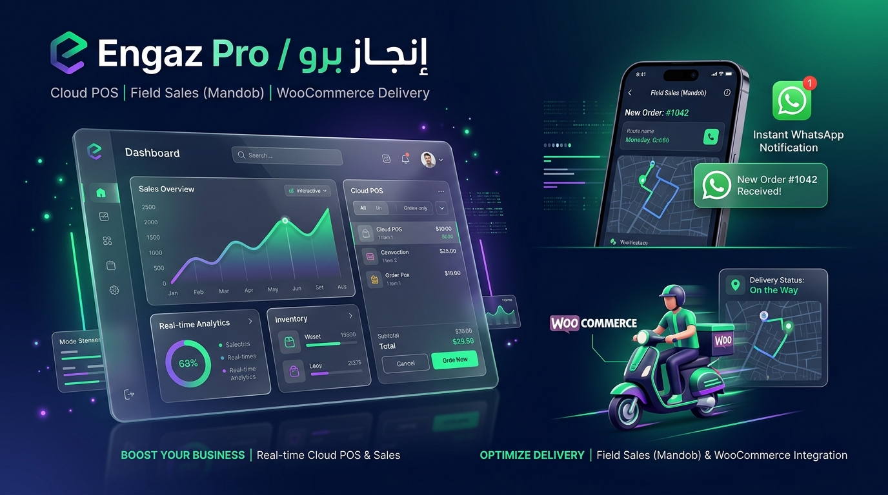
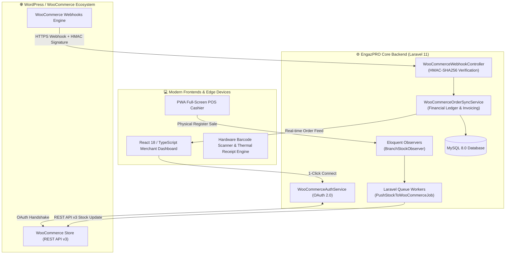

# 🚀 EngazPRO (إنجاز برو)

<p align="center">
  
</p>

> **Enterprise Omnichannel Cloud POS & Inventory Management SaaS with Real-Time Bidirectional WooCommerce Integration.**

[](https://laravel.com)
[](https://reactjs.org)
[](https://www.typescriptlang.org)
[](https://woocommerce.com)
[](https://tailwindcss.com)
[](https://www.mysql.com)
[](https://web.dev/progressive-web-apps/)

---

## 📌 Overview

**EngazPRO** is an end-to-end, high-performance Cloud Point-of-Sale (POS), multi-branch inventory, and accounting platform architected specifically for retail chains and e-commerce merchants.

The core differentiator is its **seamless, deep bidirectional integration with WordPress & WooCommerce**. Unlike generic POS solutions that rely on batch polling or third-party middleware, EngazPRO provides an **enterprise-grade, event-driven integration pipeline** that connects physical store counters directly to online WordPress stores in real time.

---

## ⚡ Key Highlights for WordPress & WooCommerce

### 1. 🔗 1-Click Official WooCommerce OAuth 2.0 Flow
* **Zero Merchant Friction**: Store owners connect their WordPress WooCommerce stores in a single click using the native WooCommerce OAuth authorization handshake.
* **Secure Token Handshake**: Exchanges encrypted consumer credentials over HTTPS, storing secured access tokens without requiring manual API copy-pasting.

### 2. 🔄 Real-Time Bidirectional Inventory Sync
* **Instant POS-to-Store Stock Reflection**: When a sale, return, or stock adjustment happens in any physical branch, an asynchronous queued job (`PushStockToWooCommerceJob`) automatically syncs the exact stock quantity back to WooCommerce.
* **Zero POS Latency**: Sync processes are dispatched to background queue workers, ensuring cashier checkouts execute in under `80ms` without waiting on WordPress network latency.

### 3. 🛡️ High-Security Webhook Pipeline (HMAC-SHA256)
* **Cryptographic Verification**: Incoming webhooks from WooCommerce (`order.created`, `order.updated`, `customer.created`) undergo strict `HMAC-SHA256` signature verification before ingestion.
* **Idempotency & Replay Protection**: Webhook payloads are verified against transaction tokens to prevent duplicate invoice generation or double-deductions.

### 4. 📦 Complete Catalog & Customer Migration Engine
* **High-Speed Batch Ingestion**: Bulk-import thousands of products, variants, SKU hierarchies, categories, and customer records from WooCommerce with smart conflict resolution and barcode generation.

### 5. 💰 Cash-On-Delivery (COD) & Courier Financial Settlement
* Specialized order management workflow for e-commerce deliveries: tracks order statuses (`processing`, `on-delivery`, `completed`, `cancelled`), shipping fees, and courier collection settlements directly tied into general ledger treasuries.

---

## 🏗️ System Architecture



---

## 🌟 Core Platform Features

* **⚡ Ultra-Fast Cashier Register (POS)**: Built with React 18, Zustand, and virtualized lists for instant search across 50,000+ items with keyboard shortcuts (`F1` to `F12`) and thermal receipt printing (ESC/POS & Web Bluetooth/USB).
* **🏢 Multi-Branch & Multi-Warehouse Management**: Transfer inventory between physical branches, track transit shipments, and isolate ledger accounting per branch.
* **📊 Double-Entry Accounting & General Ledger**: Complete tracking of daily cash register shifts, treasuries, expenses, customer credit limits, supplier accounts payable, and profit & loss statements.
* **📶 Offline-First PWA Capabilities**: Service workers cache product indices, allowing cashiers to continue issuing sales receipts even during network blips or outages.
* **🔒 Granular Role-Based Access Control (RBAC)**: Strict role hierarchy (`OWNER`, `MANAGER`, `SUPERVISOR`, `CASHIER`, `SALES_REP`) guarding operational routes.

---

## 🛠️ Technology Stack

| Domain | Technology | Key Highlights |
|---|---|---|
| **Backend API** | PHP 8.2+ / Laravel 11 | Skinny Controllers, Dedicated Service Layer, Custom Form Requests |
| **Integrations** | WooCommerce REST API v3 | Interface-driven client (`WooCommerceApiClientInterface`), GuzzleHTTP |
| **Frontend Web** | React 18 / TypeScript 5 | Vite, TailwindCSS, Headless UI, Lucide Icons |
| **State & Cache** | TanStack React Query + Zustand | Optimistic mutations, stale-while-revalidate client cache |
| **Database** | MySQL 8.0 | Strict relational integrity, foreign keys, compound indices |
| **Async Queues** | Laravel Queues (Database / Redis) | Non-blocking stock synchronization, retry backoff policies |

---

## 📁 Clean Architecture Directory Structure

```
pos-mandob/
├── backend/
│   ├── app/
│   │   ├── Contracts/                   # Interface Abstractions
│   │   │   └── WooCommerceApiClientInterface.php
│   │   ├── Http/Controllers/Api/        # Skinny HTTP Handlers
│   │   │   ├── WooCommerceAuthController.php
│   │   │   ├── WooCommerceSettingsController.php
│   │   │   └── WooCommerceWebhookController.php
│   │   ├── Jobs/                        # Asynchronous Background Queues
│   │   │   ├── PushCustomerToWooCommerceJob.php
│   │   │   └── PushStockToWooCommerceJob.php
│   │   ├── Observers/                   # Event-driven Eloquent Observers
│   │   │   └── BranchStockWooCommerceObserver.php
│   │   └── Services/WooCommerce/        # Core Business Logic Layer
│   │       ├── WooCommerceApiClient.php
│   │       ├── WooCommerceAuthService.php
│   │       ├── WooCommerceCustomerSyncService.php
│   │       ├── WooCommerceOrderSyncService.php
│   │       └── WooCommerceProductImportService.php
├── web/
│   ├── src/
│   │   ├── data/api/                    # Axios Interceptors & Base Client
│   │   ├── presentation/
│   │   │   ├── pages/                   # Application Views
│   │   │   │   ├── PosPage.tsx          # Standalone High-Speed POS Register
│   │   │   │   ├── WooCommerceSettingsPage.tsx # Integration Manager
│   │   │   │   └── WcOrdersPage.tsx     # E-commerce Fulfillment Pipeline
│   │   │   └── components/              # Modular UI Components
└── packages/
    └── shared/                          # Shared TypeScript Types & DTOs
```

---

## 🚀 Local Development Setup

### Prerequisites
* PHP >= 8.2 & Composer
* Node.js >= 18.x & npm
* MySQL 8.0

### 1. Clone the Repository
```bash
git clone https://github.com/ahmadhasandev711-web/Engazpro-.git
cd Engazpro-
```

### 2. Backend Setup
```bash
cd backend
composer install
cp .env.example .env
php artisan key:generate
php artisan migrate --seed
php artisan storage:link
php artisan serve
```

### 3. Frontend Setup
```bash
cd ../web
npm install
npm run dev
```

---

## 🛡️ Security & Enterprise Best Practices

* **Zero Magic Strings**: Comprehensive PHP Enums for order statuses, payment channels, invoice types, and user roles.
* **Transactional Integrity**: Every multi-table mutation is encapsulated within `DB::transaction()` to prevent partial state writes.
* **N+1 Query Prevention**: Eager loading is strictly applied across all repository calls and API resources.
* **Monetary Value Objects**: All currency calculations are handled with integer precision value objects (`App\Support\Money`) to avoid floating-point rounding errors.

---

## 👤 Author

**Ahmad Hasan**  
*Full-Stack Engineer & WordPress / WooCommerce Integration Specialist*  
* GitHub: [@ahmadhasandev711-web](https://github.com/ahmadhasandev711-web)

---

## 📄 License

This project is licensed under the [MIT License](LICENSE).
