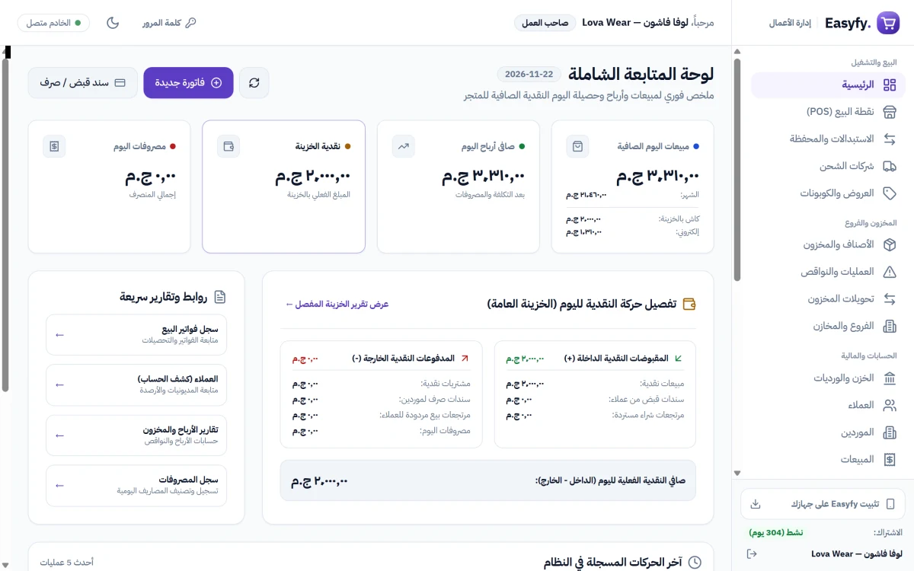
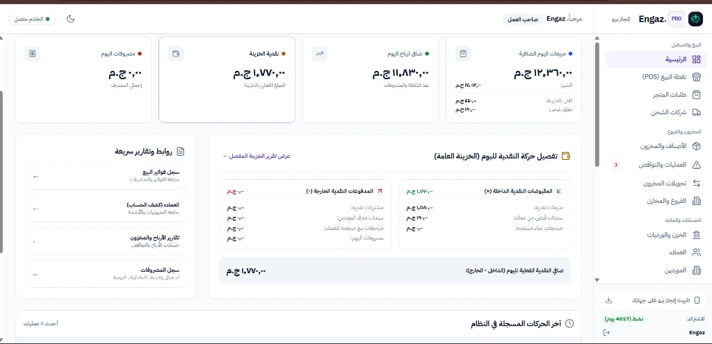
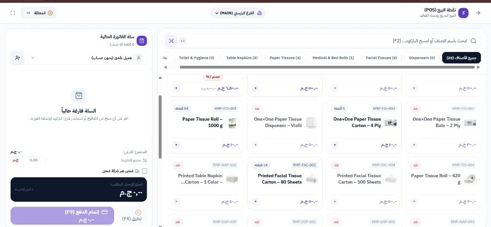
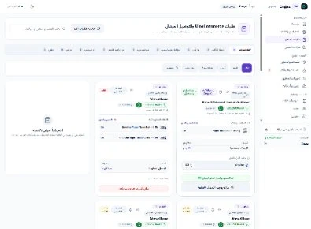
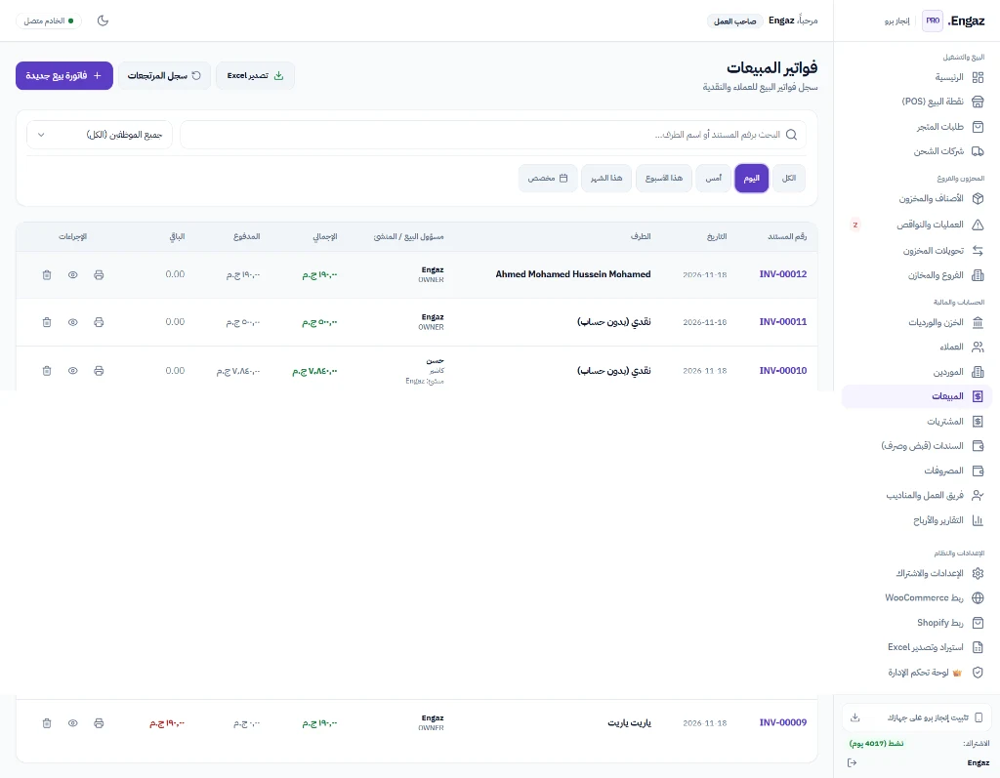
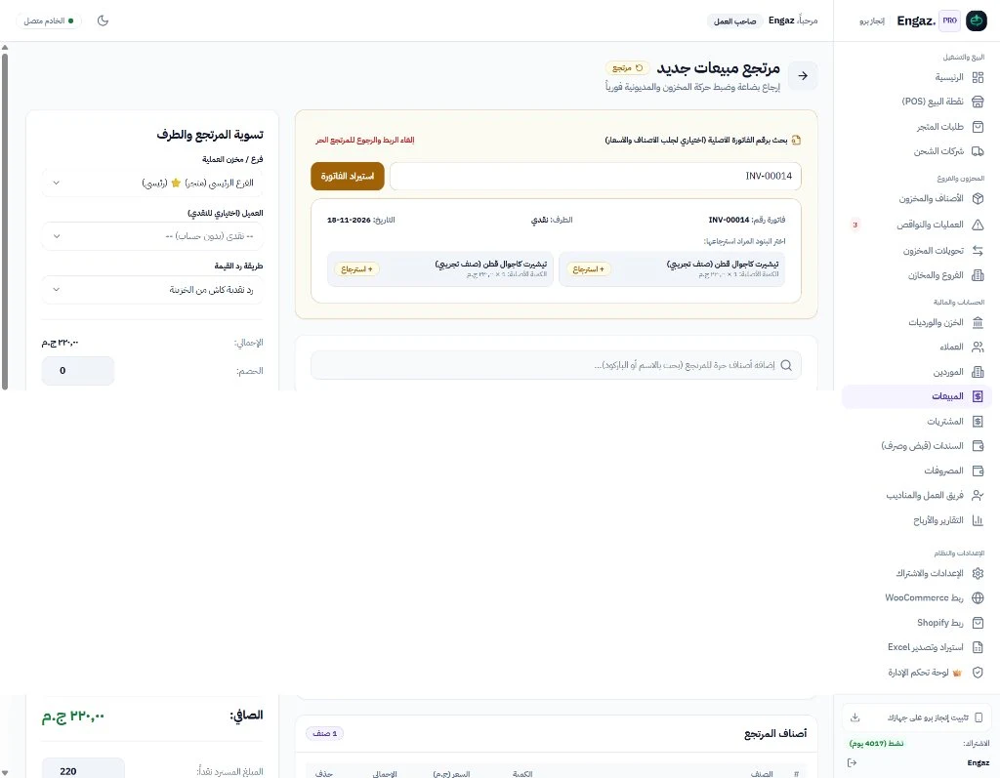
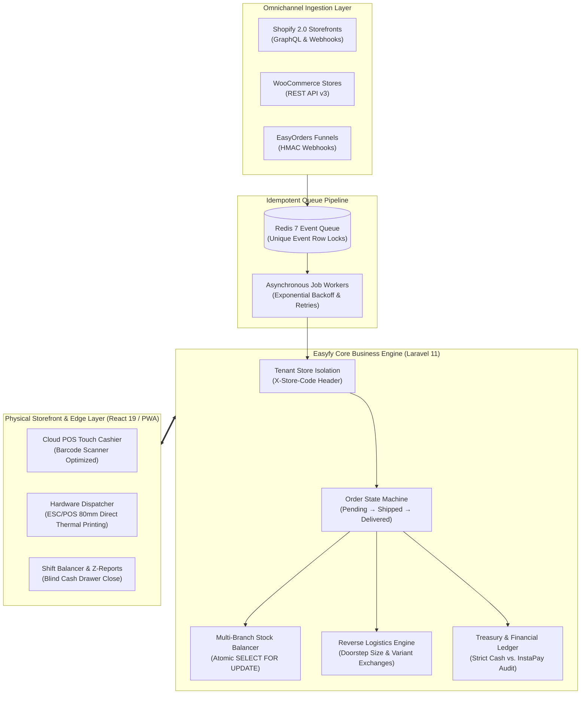

# Easyfy Cloud Commerce OS

<p align="center">
  
</p>

<p align="center">
  <strong>Enterprise Multi-Tenant DTC Operations, Multi-Branch POS & Omnichannel Integration Engine</strong>
</p>

<p align="center">
  
  
  
  
  
  
  
  
</p>

---

## 📌 Executive Overview

**Easyfy** (`easyfy.cloud`) is a production-grade cloud operating system architected for high-growth direct-to-consumer (DTC) brands and retail apparel chains across Egypt and the MENA region.

Modern omnichannel merchants face severe operational friction: fragmented stock across multiple Shopify stores, WooCommerce sites, and landing page funnels (EasyOrders), uncoordinated physical store cashiers, manual cash reconciliation, and chaotic product exchanges.

Easyfy eliminates this friction by unifying digital storefronts, multi-warehouse stock allocations, physical retail POS registers, courier cash-on-delivery (COD) custody, and automated size/variant exchanges into a single transactional source of truth.

---

## 📸 System Visual Showcase

<table width="100%">
  <tr>
    <td width="50%" valign="top">
      <h4>1. Omnichannel Operations & Real-time Metrics</h4>
      
      <p><em>Unified telemetry tracking order velocity, fulfillment queues, store channel distribution, and live branch revenue.</em></p>
    </td>
    <td width="50%" valign="top">
      <h4>2. Multi-Branch Barcode Cashier & Touch POS</h4>
      
      <p><em>Hardware-agnostic cashier register supporting fast barcode scanning, split payments, and direct 80mm ESC/POS thermal printing.</em></p>
    </td>
  </tr>
  <tr>
    <td width="50%" valign="top">
      <h4>3. Unified Store Orders & Courier Logistics</h4>
      
      <p><em>Automated synchronization with Shopify GraphQL, WooCommerce REST, and EasyOrders webhooks with courier custody assignment.</em></p>
    </td>
    <td width="50%" valign="top">
      <h4>4. Strict Treasury & Shift Z-Reports</h4>
      
      <p><em>Strict accounting discipline separating physical Cash from InstaPay, Vodafone Cash, and Visa, backed by cryptographic shift logs.</em></p>
    </td>
  </tr>
</table>

<div align="center">
  <h4>5. Smart Variant & Size Exchange Management</h4>
  
  <p><em>Automated doorstep size replacement workflow: deducts new variant inventory, accepts returned SKUs, and recalibrates courier COD balance.</em></p>
</div>

---

## 🏛️ System Architecture

Easyfy is engineered around **Domain-Driven Design (DDD)** and **Clean Hexagonal Architecture**. Every inbound event from external commerce channels passes through an idempotent ingestion pipeline before affecting the central relational ledger.



---

## ⚡ Core Engineering Highlights

### 1. Zero Overselling via Atomic Stock Locking
Flash sale traffic on connected Shopify and WooCommerce storefronts can trigger simultaneous checkout attempts on low-stock SKUs. Easyfy enforces atomic stock reservations utilizing relational `SELECT ... FOR UPDATE` locks within wrapped database transactions (`DB::transaction()`), ensuring that stock can never drop below zero regardless of concurrency.

### 2. Doorstep Size & Variant Exchange Lifecycle
Product exchanges represent up to 40% of returns for apparel retailers in Egypt. Easyfy provides an end-to-end automated exchange engine:
- Allocates and reserves the replacement variant immediately.
- Calculates price differentials and updates courier delivery cash collection fees.
- Enforces return inspection before returning previous items back to available inventory.

### 3. Strict Treasury Separation (Cash vs. InstaPay / Digital Wallets)
Retail stores often struggle with mixed payment reconciliation. Easyfy mandates strict multi-tender tracking:
- Cash payments are tracked independently per physical register drawer.
- Digital payments (InstaPay, Vodafone Cash, Fawry, POS Cards) require transaction reference IDs and are isolated from cash balances.
- Shift handover requires a **Blind Close Z-Report**, eliminating register tampering.

### 4. Zero Floating-Point Currency Inaccuracies
Every monetary calculation (item subtotals, VAT, courier delivery fees, promo discounts) is handled strictly via the immutable `Money` Value Object (`App\Support\Money`), storing amounts as integer minor units (piastres / cents) to completely eliminate binary floating-point rounding errors.

### 5. Type-Safe Contracts & Zero Magic Strings
All system states, roles, payment methods, and platform identifiers are codified via PHP 8.2 Backed Enums and TypeScript const enums, preventing runtime typographical failures across the API boundary.

---

## 📂 Repository Structure

```text
├── backend/                  # Laravel 11 Core REST API
│   ├── app/
│   │   ├── Console/Commands/ # Ops, scheduler & activation CLI commands
│   │   ├── Enums/            # Type-safe PHP 8.2 Backed Enums
│   │   ├── Http/Controllers/ # Skinny API controllers
│   │   ├── Jobs/             # Idempotent queue workers (Shopify, Woo, EasyOrders)
│   │   ├── Models/           # Eloquent entities & relationship graphs
│   │   ├── Services/         # Pure domain logic & external API adapters
│   │   └── Support/Money.php # Immutable Currency Value Object
│   ├── database/migrations/  # Versioned schema migrations
│   └── tests/                # Feature & Architecture PHPUnit test suite
├── web/                      # React 19 + TypeScript POS & Management PWA
│   ├── src/
│   │   ├── hooks/            # Modular state hooks (useProducts, useOnlineOrders)
│   │   ├── platform/         # PWA storage & hardware printer dispatchers
│   │   └── presentation/     # Clean atomic UI components & pages
│   └── public/               # Manifest, icons, and live system screenshots
├── packages/shared/          # Shared contracts, TypeScript DTOs & schemas
├── landing_easyfy/           # High-converting customer marketing showcase
└── README.md                 # Technical specification & documentation
```

---

## 🛠️ Technology Stack

| Layer | Technologies | Key Responsibilities |
|---|---|---|
| **Backend Framework** | **Laravel 11.x (PHP 8.2+)** | REST API, Sanctum authentication, job queues, transactional integrity |
| **Frontend Framework** | **React 19, TypeScript 5.8, Vite** | Reactive state, PWA capabilities, barcode scanner listener, touch cashier UI |
| **Styling & Design** | **Tailwind CSS 3.4** | Modern, accessible, responsive design with sub-second layout rendering |
| **Database & Cache** | **MySQL 8.0, Redis 7** | ACID relational storage, high-throughput queue broker, in-memory caching |
| **Commerce Integrations** | **Shopify GraphQL, WooCommerce REST, EasyOrders** | Automated bi-directional order capture and inventory stock synchronization |
| **Hardware Protocol** | **ESC/POS (80mm / 58mm)** | Native thermal receipt generation and cash drawer pulse triggers |

---

## 🚀 Local Development Setup

### Prerequisites
- **PHP 8.2 or higher** with `pdo_mysql`, `bcmath`, `curl`, `mbstring`, `redis` extensions.
- **Node.js 20+** and `npm`.
- **MySQL 8.0+** and **Redis server**.
- **Composer 2.x**.

### 1. Backend Setup (API)
```bash
cd backend

# 1. Install PHP dependencies
composer install

# 2. Configure environment file
cp .env.example .env

# 3. Generate application encryption key
php artisan key:generate

# 4. Run database migrations & seeders
php artisan migrate --seed

# 5. Start the local API server
php artisan serve --port=8000
```

### 2. Frontend Setup (PWA & POS)
```bash
cd web

# 1. Install Node dependencies
npm install

# 2. Configure environment file
cp .env.example .env

# 3. Start the Vite development server
npm run dev
```
The web application will be accessible at `http://localhost:5173`.

### 3. Running Automated Tests
```bash
cd backend

# Execute complete feature, integration, and architecture test suite
php artisan test
```

---

## 🔒 Security & Quality Standards

- **Zero Secrets Policy**: No database credentials, API keys, or JWT secrets are stored in version control.
- **Strict Tenant Isolation**: Store resources are partitioned via the `X-Store-Code` header and resolved through dedicated middleware guards.
- **Input Validation**: 100% of mutation endpoints are validated through strictly typed Laravel Form Requests.
- **Defense-in-Depth**: Rate limiting enabled on authentication endpoints, strict CORS policies, and HMAC validation on all incoming webhooks.

---

## 📄 License & Attribution

Architected and maintained by **Ahmad Hasan** ([@ahmadhasandev711-web](https://github.com/ahmadhasandev711-web)).  
Licensed under the [MIT License](LICENSE).
